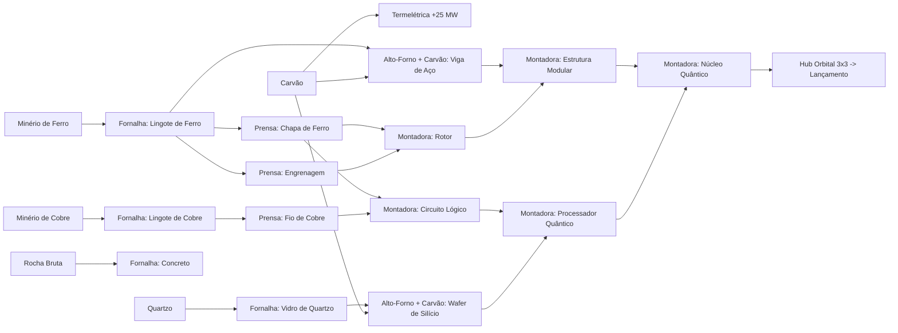

# AETHERFORGE: Orbital Foundry

[](https://lljonesll.github.io/Jogo-automacao-web/)
[](https://github.com/llJonesll/Jogo-automacao-web/releases/latest)
[](./tsconfig.json)
[](./tests/unit)
[](./LICENSE)

> **Jogar Agora (GitHub Pages):** https://lljonesll.github.io/Jogo-automacao-web/

**AETHERFORGE: Orbital Foundry** é um jogo completo de automação industrial, logística e linhas de produção direto no navegador — inspirado em *Factorio* e *Satisfactory* — construído em **TypeScript puro + HTML5 Canvas 2D + Web Audio API**, com **zero dependências de runtime**, simulação determinística a `20 Hz` e arquitetura alinhada às disciplinas **Ponytail** e **Claude Code Game Studio**.

---

## Destaques da Jogabilidade

- **Hub Orbital Central (`3x3`) & 5 Fases de Lançamento**: Entregue cargas por esteiras ou braços mecânicos em qualquer borda do Hub indestrutível para abastecer os 5 estágios do Elevador Orbital — cada fase concluída dispara um foguete animado com áudio sintetizado até a Vitória.
- **Logística Determinística Sem Viés Direcional**:
  - **Esteiras Mk.I / Mk.II / Mk.III** (`2.0`, `4.0` e `8.0 itens/s`) com colocação contínua por arraste e curvas automáticas.
  - **Túneis Subterrâneos** (até 5 blocos de alcance), **Divisores 1->3** e **Junções 3->1** round-robin.
  - **Braços Inserters Articulados** (transferem itens entre baús, esteiras e máquinas) e **Baús Logísticos** (`200` itens).
- **Ressonância Geotérmica & Overclocking (`c^1.6`)**:
  - Máquinas adjacentes a fissuras de magma ganham **+35% de velocidade gratuita**.
  - Ajuste o clock de `50%` a `250%` no Inspetor (desbloqueado no Tier 4), equilibrando velocidade linear contra consumo não-linear (`P = P0 * clock^1.6`).
- **Rede Elétrica & Ciclo Dia/Noite**: Combine RTG inicial (`15 MW`), Termelétrica a Carvão (`+25 MW`), Painéis Solares (`+8 MW` diurno), Acumuladores (`120 MJ` para suprir a noite) e Usinas Geotérmicas (`+60 MW`), com redução proporcional (`eta`) em quedas de energia.
- **Blueprints (`AFBP1:`) & Save Validado**: Selecione regiões com `Ctrl+C`, gire em `90°` com `R`, use 3 blueprints iniciais de fábrica, importe/exporte strings Base64 e salve automaticamente no navegador ou baixe `.json`.
- **Fábrica de Demonstração (Showcase)**: Um clique na tela inicial abre uma megabase viva com todas as cadeias, túneis, energia híbrida e esteiras funcionando em tempo real.
- **Painel de Calibração ao Vivo (`G`) & Localização (`PT-BR` / `EN`)**: Ajuste todos os multiplicadores de `data/config.json` em tempo real, ative Alto Contraste para daltonismo e inspecione silhuetas vetoriais em `?scene=figures` (zero emojis).

---

## Cadeia Produtiva



---

## Controles

| Ação | Atalho / Entrada |
| :--- | :--- |
| Mover câmera | `WASD` / Setas / Arrastar Botão do Meio / Clicar no Minimapa |
| Zoom | Roda do Mouse (`0.38x` – `2.2x`) |
| Selecionar ferramenta | Teclas `1`–`9`, `0` ou Barra Inferior |
| Construir esteiras em linha/curva | Clique Esquerdo e Arraste |
| Minerar jazida manualmente | Clique Esquerdo com cursor livre (`Esc`) sobre jazida |
| Desmontar (100% reembolso) | Botão Direito (ou arraste) |
| Girar máquina ou blueprint | `R` / `Shift+R` |
| Pipeta (copiar prédio sob cursor) | `Q` |
| Copiar área como Blueprint | `Ctrl+C` |
| Alt-Mode (receitas, clock e túneis) | `Alt` |
| Tecnologia & Elevador Orbital | `T` |
| Estatísticas & Telemetria (60s/min) | `P` |
| Biblioteca de Blueprints | `B` |
| Painel de Calibração (`data/config.json`) | `G` |
| Pausar / Retomar simulação | `Espaço` |
| Silenciar / Ativar áudio | `M` |
| Ajuda rápida | `H` ou `?` |

---

## Desenvolvimento Local & Testes

Requisitos: **Node.js 22.12+** (testado em Node `v24.15.0`).

```bash
npm install
npm run dev        # Servidor de desenvolvimento Vite
npm run typecheck  # Verificação estrita TypeScript (tsc --noEmit)
npm test           # Suite unitária Vitest (15 testes determinísticos)
npm run build      # Gera build estático em dist/
npm run preview    # Pré-visualização local em http://localhost:4173
```

Para auditar o catálogo completo de sprites procedurais sem emojis, abra `/?scene=figures`.

---

## CI/CD & GitHub Pages

O build estático jogável está publicado diretamente na branch `gh-pages` e acessível via GitHub Pages. Os workflows prontos do GitHub Actions (`ci.yml` e `deploy.yml`) ficam salvos em [`docs/github-workflows/`](./docs/github-workflows) para ativação opcional após conceder o escopo `workflow`:

```bash
gh auth refresh -h github.com -s workflow
git mv docs/github-workflows .github/workflows
git commit -m "ci: enable GitHub Actions CI and Pages workflows" && git push
```

---

## Arquitetura, Ponytail & Game Studio

- **Zero dependências de runtime**: `package.json` possui apenas `devDependencies` (`typescript`, `vite`, `vitest`).
- **Arte 100% procedural**: Zero emojis ou fontes de ícones em `src/`, `data/` e `index.html`; todos os 19 itens e 20 edifícios possuem silhuetas Canvas 2D dedicadas.
- **Dívida técnica explícita**: Toda simplificação intencional é marcada com `// shortcut: <ceiling>, <upgrade path>` e rastreada em [`PONYTAIL-DEBT.md`](./PONYTAIL-DEBT.md).
- **Documentação de Estúdio**:
  - Brief & GDD: [`design/game-brief.md`](./design/game-brief.md), [`design/gdd/factory-systems.md`](./design/gdd/factory-systems.md)
  - Arquitetura: [`docs/architecture/architecture.md`](./docs/architecture/architecture.md)
  - Checklist de Release: [`production/releases/release-checklist-v1.0.0.md`](./production/releases/release-checklist-v1.0.0.md)

---

## Versionamento (SemVer)

| Tag | Marco |
| :--- | :--- |
| `v0.1.0` | Fundação Vite/TS, GDD/Arquitetura, tabelas `data/*.json` e gerador de mundo `mulberry32` |
| `v0.2.0` | Simulação determinística em 2 fases (`20 Hz`), esteiras simétricas, túneis, divisores e receitas |
| `v0.3.0` | Rede elétrica, overclock `c^1.6`, 6 tiers Tech, 5 fases orbitais, blueprints `AFBP1:` e save |
| `v0.4.0` | Renderizador 2.5D Canvas, áudio procedural Web Audio, HUD PT-BR/EN e hook `window.game` |
| `v1.0.0` | QA completo em navegador, polimento visual, publicação no GitHub Pages (`gh-pages`) e release público |
