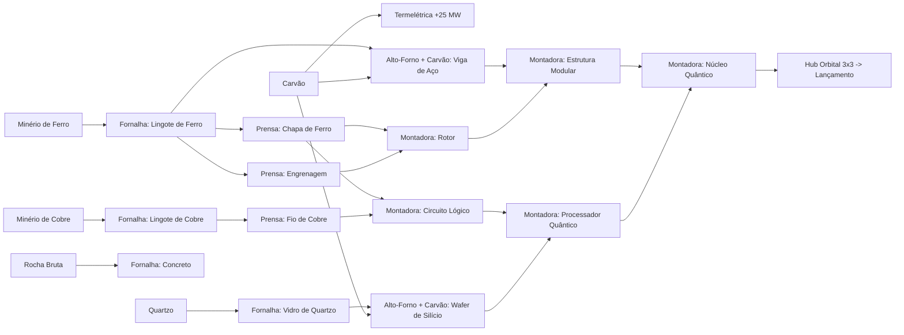

# AETHERFORGE: Orbital Foundry

[](https://lljonesll.github.io/Jogo-automacao-web/)
[](https://github.com/llJonesll/Jogo-automacao-web/releases/latest)
[](./tsconfig.json)
[](./tests/unit)
[](./LICENSE)

> **Jogar Agora (GitHub Pages):** https://lljonesll.github.io/Jogo-automacao-web/

**AETHERFORGE: Orbital Foundry** é um jogo completo de automação industrial, logística e linhas de produção direto no navegador — inspirado em *Factorio* e *Satisfactory* — construído em **TypeScript puro + HTML5 Canvas 2D + Web Audio API**, com **zero dependências de runtime**, simulação determinística a `20 Hz` e arquitetura alinhada às disciplinas **Ponytail** e **Claude Code Game Studio**.

---

## Destaques da Jogabilidade (`v1.1.0`)

- **Hub Orbital Central (`3x3`) & 5 Fases de Lançamento**: Entregue cargas por esteiras ou braços mecânicos em qualquer borda do Hub indestrutível para abastecer os 5 estágios do Elevador Orbital — cada fase concluída dispara um foguete animado (pulável com `Espaço`/`Enter`/botão) com partículas e áudio sintetizado até a Vitória.
- **Logística Determinística Sem Viés Direcional**:
  - **Esteiras Mk.I / Mk.II / Mk.III** (`2.0`, `4.0` e `8.0 itens/s`) com colocação contínua por arraste, curvas vetoriais e interpolação sub-tick `simAlpha` a `60 FPS`.
  - **Túneis Subterrâneos** (até 5 blocos de alcance, pareamento bidirecional e buffer seguro de `4` itens sem par), **Divisores 1->3** e **Junções 3->1** a `8.0/s`.
  - **Braços Inserters Articulados** (2 segmentos com garra rotativa) e **Baús Logísticos** (`200` itens) com reembolso integral de custo + buffers ao desmontar.
- **Ressonância Geotérmica, Overclocking (`c^1.6`) & Sobrecarga Orbital**:
  - Máquinas adjacentes a fissuras de magma ganham **+35% de velocidade gratuita**.
  - Ajuste o clock de `50%` a `250%` no Inspetor (desbloqueado no Tier 4), equilibrando velocidade linear contra consumo não-linear (`P = P0 * clock^1.6`).
  - O **Tier 6 (`orbital_ascension`)** desbloqueia **Sobrecarga Orbital** (`+50%` de velocidade global) e o **Tier 4/5** protege receitas quânticas.
- **Rede Elétrica & Ciclo Dia/Noite**: Combine RTG inicial (`20 MW`), Termelétrica a Carvão (`+25 MW`, `4.0s/carvão`), Painéis Solares (`+14 MW` diurno), Acumuladores (`180 MJ`, `15 MW`) e Usinas Geotérmicas (`+60 MW`), com redução proporcional (`eta`), camada visual da rede (`V`) e alertas de queda/estabilização.
- **Blueprints (`AFBP1:`) & Save Validado**: Capture regiões com `Ctrl+C`, gire em `90°` com `R`, use 3 blueprints iniciais, importe/exporte strings Base64 e salve no navegador ou `.json` com validação estrita fail-closed.
- **Áudio Procedural Web Audio & Acessibilidade WCAG 2.1 AA**: Mixagem em barramentos (`Master`, `SFX`, `UI`, `Ambiente`) com compressor anti-clipping, modo **Mono**, legenda visual via toasts em fila, **4 modos de daltonismo** com ícones geométricos, **escala de texto** (`100%–150%`), **Movimento Reduzido**, **Cursor por Teclado (`I/J/K/L`)**, suporte completo a **Gamepad**, e localização `PT-BR` / `EN` (`?lang=en`).
- **Fábrica de Demonstração (Showcase) & `?scene=figures`**: Um clique na tela inicial abre uma megabase viva (`78` estruturas); `/?scene=figures` exibe todas as silhuetas Canvas 2D (`19` itens + `20` estruturas, zero emojis).

---

## Cadeia Produtiva



---

## Controles

| Ação | Atalho / Entrada |
| :--- | :--- |
| Mover câmera | `WASD` / Setas / Arrastar Botão do Meio / Clicar no Minimapa / Analógico Esq. |
| Cursor por Teclado / Gamepad | `I` / `J` / `K` / `L` (ou Analógico Dir./D-Pad), `Enter`/`A` aplica, `Delete`/`Backspace`/`B` desmonta |
| Zoom | Roda do Mouse (`0.38x` – `2.2x`) / `LT` / `RT` |
| Selecionar ferramenta / Categoria | `1`–`9`, `0`, `[` / `]`, `LB` / `RB` ou Barra Inferior |
| Construir esteiras em linha/curva | Clique Esquerdo e Arraste |
| Minerar jazida manualmente | Clique Esquerdo com cursor livre (`Esc`) ou Laser sobre jazida |
| Desmontar (100% reembolso + buffers) | Botão Direito (ou arraste) / `Delete` |
| Girar máquina ou blueprint | `R` / `Shift+R` / `X` (Gamepad) |
| Pipeta (copiar prédio sob cursor) | `Q` / `Y` (Gamepad) |
| Copiar área como Blueprint | `Ctrl+C` |
| Alt-Mode / Camada Elétrica | `Alt` (`Select`) / `V` |
| Modais (`Tech`, `Stats`, `Blueprints`, `Config`) | `T` / `P` / `B` / `G` |
| Pausar / Pular lançamento / Áudio / Ajuda | `Espaço` / `M` / `H` ou `?` (`Start`) / `Home` (Centralizar no Hub) |

---

## Desenvolvimento Local & Testes

Requisitos: **Node.js 22.12+** (testado em Node `v24.15.0`).

```bash
npm install
npm run dev        # Servidor de desenvolvimento Vite
npm run typecheck  # Verificação estrita TypeScript (tsc --noEmit)
npm test           # Suite unitária Vitest (7 arquivos, 32 testes: schemas, i18n, fuzz, soak)
npm run build      # Gera build estático em dist/
npm run preview    # Pré-visualização local em http://localhost:4173
```

Para auditar o catálogo completo de sprites procedurais sem emojis, abra `/?scene=figures` (ou `/?scene=figures&lang=en`).

---

## CI/CD & GitHub Pages

O build estático jogável pode ser publicado diretamente via `gh-pages`. Os workflows prontos do GitHub Actions (`ci.yml` e `deploy.yml`) ficam salvos em [`docs/github-workflows/`](./docs/github-workflows) para ativação opcional após conceder o escopo `workflow`:

```bash
gh auth refresh -h github.com -s workflow
git mv docs/github-workflows .github/workflows
git commit -m "ci: enable GitHub Actions CI and Pages workflows" && git push
```

---

## Arquitetura, Ponytail & Game Studio

- **Zero dependências de runtime**: `package.json` possui apenas `devDependencies` (`typescript`, `vite`, `vitest`); `npm audit --omit=dev` reporta `0` vulnerabilidades.
- **Arte 100% procedural**: Zero emojis ou fontes de ícones em `src/`, `data/`, `index.html`, `design/` e `docs/`; todos os 19 itens e 20 edifícios possuem silhuetas Canvas 2D dedicadas.
- **Dívida técnica explícita**: Toda simplificação intencional é marcada com `// shortcut: <ceiling>, <upgrade path>` e rastreada em [`PONYTAIL-DEBT.md`](./PONYTAIL-DEBT.md) (`8` marcadores registrados).
- **Documentação de Estúdio**:
  - Conceito, Sistemas & GDD: [`design/gdd/game-concept.md`](./design/gdd/game-concept.md), [`design/gdd/systems-index.md`](./design/gdd/systems-index.md), [`design/gdd/factory-systems.md`](./design/gdd/factory-systems.md), [`design/registry/entities.yaml`](./design/registry/entities.yaml)
  - Arte, UX, Áudio & Acessibilidade: [`design/art/art-bible.md`](./design/art/art-bible.md), [`design/ux/hud.md`](./design/ux/hud.md), [`design/audio/sound-bible.md`](./design/audio/sound-bible.md), [`design/accessibility-requirements.md`](./design/accessibility-requirements.md)
  - Arquitetura & Schemas: [`docs/architecture/architecture.md`](./docs/architecture/architecture.md), [`docs/architecture/control-manifest.md`](./docs/architecture/control-manifest.md), [`data/schemas/`](./data/schemas)
  - QA, Segurança, Performance & Release: [`production/qa/qa-signoff-v1.1.0-2026-11-17.md`](./production/qa/qa-signoff-v1.1.0-2026-11-17.md), [`production/security/security-audit-2026-11-17-full.md`](./production/security/security-audit-2026-11-17-full.md), [`production/polish/factory-report-2026-11-17.md`](./production/polish/factory-report-2026-11-17.md), [`production/releases/release-checklist-v1.1.0.md`](./production/releases/release-checklist-v1.1.0.md)

---

## Versionamento (SemVer)

| Tag | Marco |
| :--- | :--- |
| `v0.1.0` | Fundação Vite/TS, GDD/Arquitetura, tabelas `data/*.json` e gerador de mundo `mulberry32` |
| `v0.2.0` | Simulação determinística em 2 fases (`20 Hz`), esteiras simétricas, túneis, divisores e receitas |
| `v0.3.0` | Rede elétrica, overclock `c^1.6`, 6 tiers Tech, 5 fases orbitais, blueprints `AFBP1:` e save |
| `v0.4.0` | Renderizador 2.5D Canvas, áudio procedural Web Audio, HUD PT-BR/EN e hook `window.game` |
| `v1.0.0` | QA inicial em navegador, publicação no GitHub Pages (`gh-pages`) e release público |
| `v1.1.0` | Refinamento multi-pilar Game Studio: engine zero-alloc (`0.095 ms/tick`), partículas SoA + caches offscreen, mixagem Web Audio + ambiente, WCAG 2.1 AA + Gamepad, schemas JSON, fuzz/soak (`32/32` testes) e auditorias completas |
